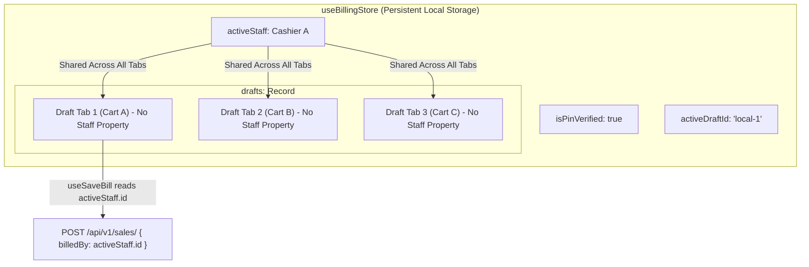

# Cashier State & Billing Association Audit Report

**Date:** 2026-10-23  
**Status:** Read-Only System Audit Complete (Zero Code Modifications)  
**Target Systems:** `apps/frontend/store/billingStore.ts`, `apps/frontend/hooks/useSaveBill.ts`, `apps/frontend/hooks/useCheckout.ts`, `apps/frontend/utils/payloadBuilders.ts`, `apps/backend/apps/billing/views.py`

---

## Executive Summary

This audit assesses how cashier identity is captured, scoped, persisted, and submitted across open billing tabs in MediFlow.

**Key Finding:** The system currently operates on a **1-to-Many Global Association Model**. Cashier identity (`activeStaff`) is a top-level singleton in the Zustand store and is shared across all open draft tabs. Individual drafts (`DraftBill`) contain no staff or cashier metadata. When a bill is finalized, the payload unconditionally attributes the sale to the currently active global cashier (`billingStore.activeStaff.id`).

---

## Part 1: Zustand Store & State Audit

### 1. State Structure (`apps/frontend/store/billingStore.ts`)

- **Global Cashier Singleton:**
  ```typescript
  interface BillingState {
      drafts: Record<string, DraftBill>;
      activeDraftId: string | null;

      activeStaff: StaffPinVerifyResponse | null;
      isPinVerified: boolean;
      // ...
  }
  ```
  `activeStaff` is stored strictly at the root level of `BillingState`. 
- **Draft Data Model:**
  `DraftBill` in [`apps/frontend/types/index.ts`](file:///home/asta/coding/MDF/apps/frontend/types/index.ts#L494-L533) has **no staff identifier** (no `staffId`, `staff`, or `cashierId`).
- **Draft Creation (`createDraft`):**
  [`createDraft`](file:///home/asta/coding/MDF/apps/frontend/store/billingStore.ts#L164-L178) initializes an empty draft via `createEmptyDraft(id)`. It does not record or snapshot the cashier who created the draft.
- **Draft Switching (`switchDraft`):**
  [`switchDraft`](file:///home/asta/coding/MDF/apps/frontend/store/billingStore.ts#L180-L185) simply updates `activeDraftId: id`. It leaves `activeStaff` completely untouched.

### 2. Persistence Configuration

- **Middleware:** Zustand `persist` with `localStorage` key `'mediflow-billing-drafts'`.
- **`partialize` Mapping ([`billingStore.ts: L698-L705`](file:///home/asta/coding/MDF/apps/frontend/store/billingStore.ts#L698-L705)):
  ```typescript
  partialize: (state) => ({
      drafts: state.drafts,
      activeDraftId: state.activeDraftId,
      activeStaff: state.activeStaff,
      isPinVerified: state.isPinVerified,
      showMarginInfo: state.showMarginInfo,
      billsToday: state.billsToday,
  }),
  ```
- **Result:** Both `activeStaff` and `isPinVerified` are **fully persisted** in browser local storage alongside the open drafts. If the browser is refreshed or closed mid-shift, the active cashier session and all open carts are retained without re-prompting for a PIN.

---

## Part 2: Payload & API Audit

### 1. Checkout Data Flow

The checkout journey propagates as follows:
1. **User Action:** The user clicks "Complete Sale" in the UI, triggering `useCheckout.ts`.
2. **Delegation:** [`useCheckout.ts`](file:///home/asta/coding/MDF/apps/frontend/hooks/useCheckout.ts#L100) calls `await saveBill()` from [`useSaveBill.ts`](file:///home/asta/coding/MDF/apps/frontend/hooks/useSaveBill.ts#L18).
3. **Identity Extraction ([`useSaveBill.ts: L45-L54`](file:///home/asta/coding/MDF/apps/frontend/hooks/useSaveBill.ts#L45-L54)):
   ```typescript
   const state = useBillingStore.getState();
   const activeStaff = state.activeStaff;

   if (!resolvedOutletId || !activeStaff?.id) {
       throw {
           type: 'AUTH_ERROR',
           message: 'Your session has expired. Please log in again.',
           requiresReauth: true,
       };
   }
   ```
   *Note:* The checkout flow strictly requires `activeStaff.id` from `useBillingStore`. It does not fall back to `useAuthStore` on the frontend.
4. **Payload Construction ([`payloadBuilders.ts: L81`](file:///home/asta/coding/MDF/apps/frontend/utils/payloadBuilders.ts#L81)):**
   ```typescript
   export function buildSalePayload(draft: any, scheduleHData: any, totals: any, activeStaff: any, resolvedOutletId: string): any {
       // ...
       return {
           // ...
           billedBy: activeStaff?.id,
           // ...
       };
   }
   ```

### 2. Backend Association

- **JSON Key:** The API contract requires the property **`billedBy`** (string UUID).
- **Backend Handler ([`apps/backend/apps/billing/views.py: L570-L582`](file:///home/asta/coding/MDF/apps/backend/apps/billing/views.py#L570-L582)):
  ```python
  # Get billed_by staff (from request payload if PIN verified, fallback to request user)
  billed_by_id = request.data.get('billedBy')
  try:
      if billed_by_id:
          billed_by = Staff.objects.get(id=billed_by_id)
      else:
          billed_by = Staff.objects.get(id=request.user.id)
  except Staff.DoesNotExist:
      billed_by = None
  ```
- **Database Model:** Stored as `SaleInvoice.billed_by` (Foreign key to `accounts.Staff`).
- **Permission Check:** The backend also extracts `billed_by.max_discount` to enforce that line and bill discounts do not exceed the specific cashier's authorized limit.

---

## Part 3: Data Model & Association Summary



- **Association Cardinality:** **1-to-Many** (One global cashier controls all open tabs).
- **Tab Ownership:** There is currently no per-tab cashier memory. If Cashier A creates Tab 1 and walks away, and Cashier B enters their PIN to bill Tab 2, Tab 1 is automatically billed under Cashier B if checked out without switching back.

---

## Part 4: Execution Blueprint & Recommendation

When implementing the **"Quick Switch" PIN modal**, we must choose between updating the global `activeStaff` or scoping staff per draft.

### Option A: Global `activeStaff` Update (Recommended for Phase 1)
- **Mechanism:**
  The Quick Switch modal prompts for a 4-digit PIN, validates it against `staffApi.lookupByPin(pin, outletId)`, and invokes:
  ```typescript
  useBillingStore.getState().setActiveStaff(newStaffResponse);
  ```
- **Pros:**
  1. **Zero Schema Migration:** No modifications required to `DraftBill` interface, drafts dictionary, or offline persistence format.
  2. **Zero Payload Changes:** Existing `buildSalePayload` and `useSaveBill` continue to function without edits.
  3. **Aligns with Single-Terminal Workflow:** In a retail pharmacy counter, one physical human cashier operates the keyboard/scanner at any moment. When Cashier B steps up, they are the operator of the entire terminal session.
  4. **Immediate Visibility:** The header badge in [`ActiveBillsTabs.tsx`](file:///home/asta/coding/MDF/apps/frontend/components/billing/ActiveBillsTabs.tsx#L121-L128) and [`TransactionStrip.tsx`](file:///home/asta/coding/MDF/apps/frontend/components/billing/TransactionStrip.tsx#L25) immediately updates to show the new cashier's name and role without re-rendering individual carts.
- **Risk / Consideration:**
  If Cashier B finalizes a draft started by Cashier A, the sale and its commission/audit trail are credited to Cashier B (the person who completed and authorized the checkout). In retail POS accounting, this is generally acceptable or even preferred, as the completing cashier is legally responsible for cash drawer reconciliation and discount authorization.

---

### Option B: Hybrid Scoped Staff (`draft.staff` with Global Fallback)
- **Mechanism:**
  1. Add `staff?: StaffPinVerifyResponse` to `DraftBill`.
  2. On `createDraft()`, attach the current `activeStaff`.
  3. In Quick Switch modal, provide two choices: *"Switch Terminal Cashier (Global)"* vs *"Reassign This Bill"*.
  4. When switching tabs, optionally switch `activeStaff` or visually indicate *"Draft started by [Cashier A]"*.
- **Pros:**
  Preserves attribution for who initiated the basket vs who collected payment.
- **Cons:**
  Higher cognitive load for cashiers at high-speed counters, risk of discount validation mismatches (e.g., Cashier A was allowed 10% discount, but Cashier B taking over has max discount of 5%).

---

### Architect's Recommendation

**Proceed with Option A (Global `activeStaff` Update) with an optional attribution watermark:**
1. **Quick Switch Behavior:** Clicking the staff badge in [`ActiveBillsTabs.tsx`](file:///home/asta/coding/MDF/apps/frontend/components/billing/ActiveBillsTabs.tsx#L121) opens a lightweight `QuickSwitchPinModal`.
2. **On Valid PIN:** 
   - Call `setActiveStaff(newStaff)`.
   - Update `activeStaff` globally in `useBillingStore`.
   - Display a brief toast: `"Switched cashier to [Staff Name]"`.
   - The open draft, cart items, customer selection, and active tab are preserved 100% without interruption.
3. **Optional Safety Enhancement:** Add an optional audit stamp `createdByStaffName?: string` to `DraftBill` purely for informational display in the tab header (e.g., *"Tab 1 (started by Rahul)"*), while letting `activeStaff.id` govern the actual `billedBy` checkout authorization.
